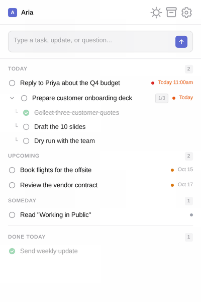
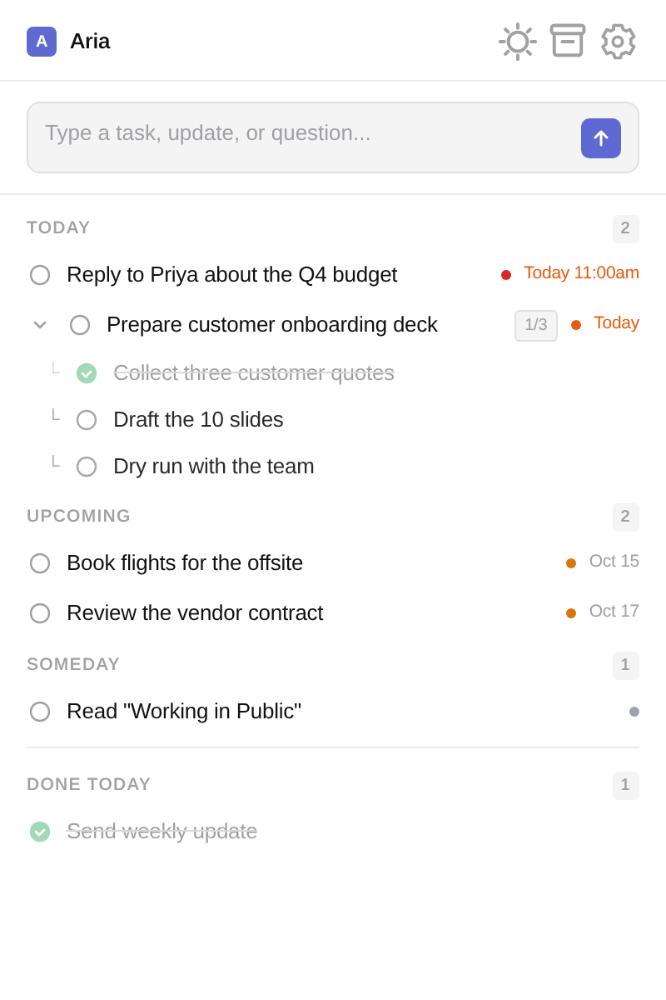
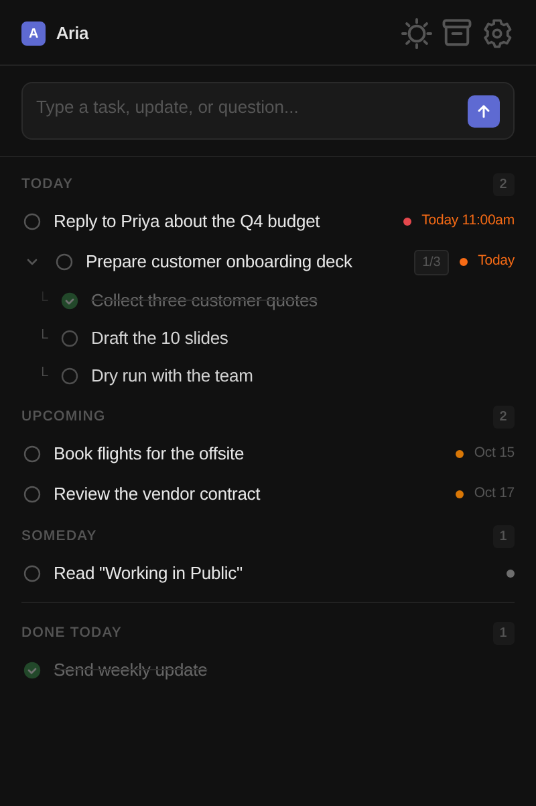

<h1 align="center">Aria</h1>

<p align="center"><b>Type what's on your mind. Aria turns it into a prioritized task list in your Mac menu bar.</b><br>A tiny AI task manager powered by Claude. Bring your own Anthropic key. Your tasks never leave your Mac except to reach Anthropic.</p>

<p align="center">
  <a href="LICENSE"></a>
  <a href="#install"></a>
  <a href="https://www.electronjs.org"></a>
  <a href="#privacy"></a>
  <a href="https://github.com/snahar7/aria/actions/workflows/ci.yml"></a>
</p>

<p align="center">
  <a href="https://github.com/snahar7/aria/releases/latest/download/Aria-1.0.0-mac-arm64.dmg"></a>
  &nbsp;
  <a href="https://github.com/snahar7/aria/releases/latest/download/Aria-1.0.0-mac-x64.dmg"></a>
  &nbsp;
  <a href="https://github.com/snahar7/aria/releases/latest"></a>
</p>

<p align="center">
  <a href="#quick-start">Quick start</a> ·
  <a href="#features">Features</a> ·
  <a href="#how-it-works">How it works</a> ·
  <a href="#privacy">Privacy</a> ·
  <a href="#limits">Limits</a> ·
  <a href="#build-from-source">Build from source</a> ·
  <a href="#faq">FAQ</a>
</p>

<p align="center">
  
</p>
<p align="center"><sub>One sentence in, a scheduled task with steps out. Recorded from the real UI with sample data.</sub></p>

---

Most to-do apps want you to fill in a form: title, date, priority, project. Aria skips the form. Click the **A** in your menu bar, type the way you'd text a colleague ("reply to Priya about the budget before 11", "the launch slipped to next week", "what's left today?"), and Claude decides whether that's a new task, an update, a completion or a question. Aria sets the date, priority, time estimate and steps, and it spots duplicates.

## Quick start

1. [Download Aria](https://github.com/snahar7/aria/releases/latest) (the `.dmg` for your Mac), drag it to Applications, and **right-click → Open** the first time (it isn't notarized; see [FAQ](#faq)).
2. Click the **A** in the menu bar, open **Settings**, and paste an Anthropic API key from [console.anthropic.com](https://console.anthropic.com).
3. Type `remind me to send the deck to Maya tomorrow at 10` and press Enter.

## Features

- **Natural language in, structured tasks out.** Create, update, complete, cancel, add steps, reprioritize several tasks at once, or just ask a question.
- **Smart defaults.** Due dates are never in the past, priorities run urgent → low, and time estimates follow simple rules (an email reply takes about 15 minutes, a deck takes about 3 hours).
- **Duplicate detection.** "Send Maya the contract" updates your existing Maya task instead of creating a second one.
- **Today, Upcoming, Someday and Done Today** sections. Finished tasks move to the archive after midnight.
- **Undo** the last AI change with one click.
- **Clarifying questions** when it can't tell which task you mean.
- **Offline queue.** Inputs typed without a connection are kept and sent when you're back online.
- **Light and dark** themes, drag to reorder, export to JSON, and launch at login.
- **Menu-bar only.** No Dock icon and no window switcher entry. It hides when you click away.
- **Pick your model.** It defaults to `claude-opus-4-5`. Change it in **Settings → Model**, or set `ARIA_MODEL`.

<p align="center">
  
  &nbsp;&nbsp;
  
</p>

## How it works

```text
menu bar "A" ──click──▶ panel (src/index.html + renderer.js)
                              │  window.aria.* (contextBridge, src/preload.js)
                              ▼
                     main process (src/main.js)
                       │                      │
          src/ai.js: one HTTPS call     src/database.js: JSON files
          to api.anthropic.com           in ~/Library/Application Support/Aria/data
```

- **[`src/ai.js`](src/ai.js)** builds a system prompt with your name, your work context, today's date and your current task list. It asks Claude to reply with exactly one JSON action (`create`, `update`, `complete`, `cancel`, `add-subtask`, `bulk-update`, `answer` or `clarify`). It uses plain `fetch`, with no SDK.
- **[`src/main.js`](src/main.js)** applies that action to the local store and returns the new list. It also owns the tray icon and the frameless panel.
- **[`src/preload.js`](src/preload.js)** is the only bridge between the UI and Node. The renderer runs with `contextIsolation` and no Node access, behind a strict Content-Security-Policy.
- **[`src/database.js`](src/database.js)** keeps `tasks.json`, `archive.json`, `settings.json` and an undo snapshot.

## Privacy

- **Your tasks and settings stay on your Mac**, as JSON files in `~/Library/Application Support/Aria/data`. There's no Aria server, account, analytics or telemetry.
- **Your API key stays on your device.** It's saved in `settings.json` in that folder and sent only to `api.anthropic.com`, in the `x-api-key` header. It's stored as plain text, like most CLI configs, so treat that folder as you would `~/.aws`.
- **What goes to Anthropic:** each time you press Enter, Aria sends what you typed, your name and work context from Settings, and a summary of your active tasks. That data falls under [Anthropic's API terms](https://www.anthropic.com/legal/commercial-terms).
- **Reset Everything** in Settings clears your key and profile. Deleting the data folder removes everything.

## Limits

- **macOS only.** The panel, tray and vibrancy are built for the Mac menu bar. It launches on Linux for development, but it isn't supported there.
- **Not notarized.** The builds are ad-hoc signed, not Developer ID signed, so Gatekeeper warns on first launch.
- **Costs are yours.** Every input is one Claude API call on your key. A cheaper model can be set in **Settings → Model**.
- **Needs a connection** for anything the AI does. Offline inputs are queued, not processed.
- **No sync.** It runs on one Mac with no cloud or mobile app, by design.

## Build from source

You need Node.js 20+ and npm.

```sh
git clone https://github.com/snahar7/aria.git && cd aria
npm ci
npm start          # run it from source
npm run lint       # syntax checks, broken-file references, secret scan
npm test           # unit tests for the Claude integration (fetch is mocked)
npm run dist       # build dist/Aria-<version>-mac-{arm64,x64}.{dmg,zip}
```

Electron is the only runtime dependency, and electron-builder packages the app. `node scripts/capture.cjs` regenerates the images in `docs/` from the real UI, using sample data and a mocked backend (it needs Playwright and ffmpeg).

## FAQ

<details>
<summary><b>macOS says Aria "can't be opened" or "is damaged"</b></summary>

<br>

The build isn't notarized by Apple. Either right-click Aria in Applications and choose **Open**, then **Open** again, or run:

```sh
xattr -dr com.apple.quarantine /Applications/Aria.app
```

On recent macOS versions you may instead need **System Settings → Privacy & Security → Open Anyway**.
</details>

<details>
<summary><b>Where do I get an API key, and what does it cost?</b></summary>

<br>

Create one at [console.anthropic.com](https://console.anthropic.com) → API Keys. You pay Anthropic per use. Each input is a single request with a short reply (up to 1,024 tokens). For lower costs, pick a smaller model in Settings.
</details>

<details>
<summary><b>Which model does it use? Can I change it?</b></summary>

<br>

`claude-opus-4-5` by default. Enter any Anthropic model id in **Settings → Model**, or launch with `ARIA_MODEL=<model id>`. The Settings value wins.
</details>

<details>
<summary><b>I don't see the icon</b></summary>

<br>

Aria is a menu-bar app with no Dock icon. Look for a bold **A** near the clock. On a crowded menu bar it may be hidden behind the notch, so a menu-bar manager or fewer icons helps. Right-click the **A** to quit.
</details>

<details>
<summary><b>Can I use it without Anthropic, like a local model?</b></summary>

<br>

Not today. `src/ai.js` is about 200 lines, so wiring up another provider is a small change, and pull requests are welcome.
</details>

## License

[MIT](LICENSE) © 2026 Shubham Nahar · [github.com/snahar7](https://github.com/snahar7)
